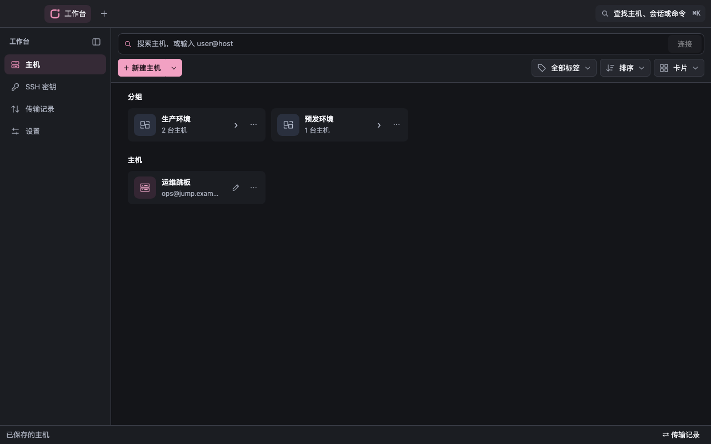
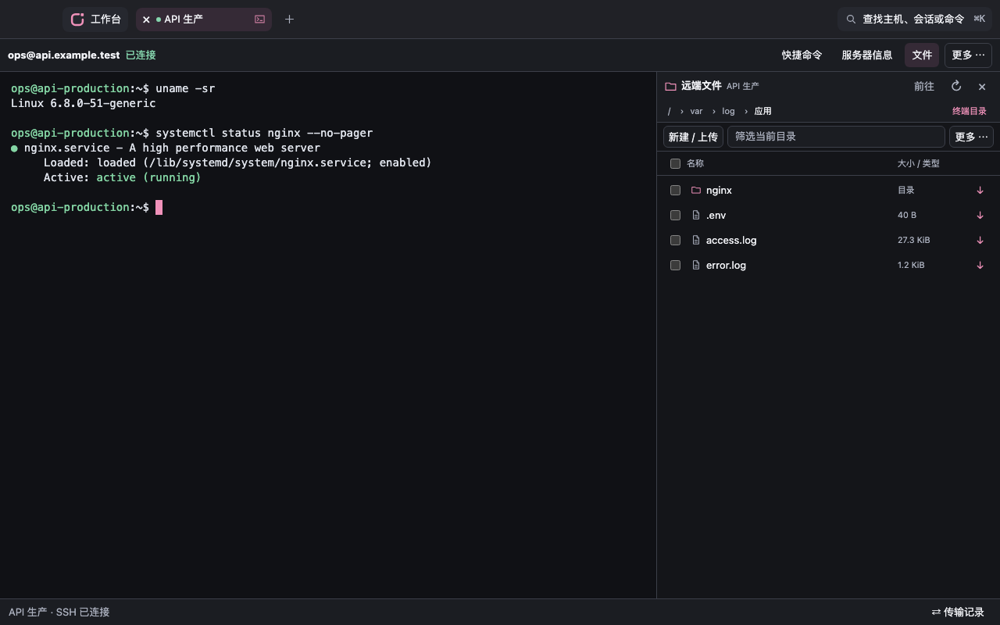
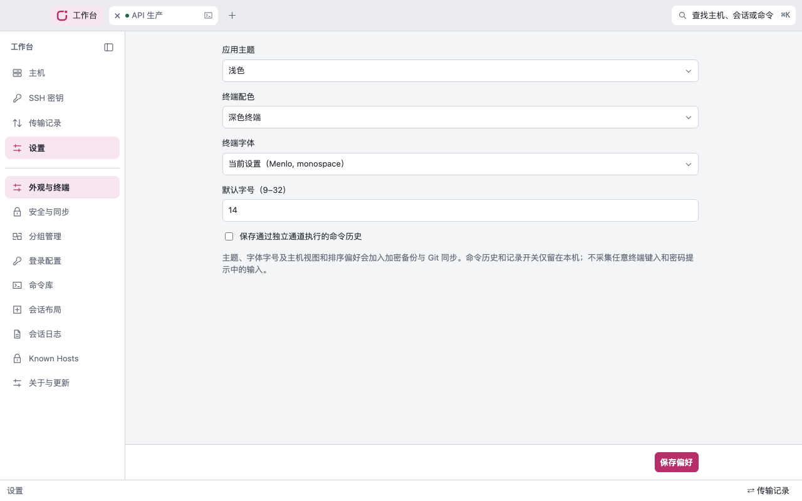

# Termlume

<picture>
  <source media="(prefers-color-scheme: dark)" srcset="assets/brand/logo-on-dark.svg">
  
</picture>

**English** | [简体中文](README.zh-CN.md)

Termlume is a desktop SSH workspace for macOS and Windows. Manage hosts, work in terminal tabs and split panes, transfer files over SFTP, and inspect server metrics in one window. Your workspace stays on your device, with optional encrypted backups and synchronization through your own private Git repository.

[Download](https://github.com/ingot-cloud/termlume/releases/latest) · [All releases](https://github.com/ingot-cloud/termlume/releases) · [Report an issue](https://github.com/ingot-cloud/termlume/issues) · [Documentation](#documentation)

**Product tour** (57 seconds, in Chinese) · [Download the 1080p video](docs/assets/termlume-intro.mp4?raw=true)

https://github.com/user-attachments/assets/7d1508ec-2bad-4319-ac6d-3c3f4bbb2834

- [Features](#features)
- [Workspace pages](#workspace-pages)
- [Install and get started](#install-and-get-started)
- [Security and synchronization](#security-and-synchronization)
- [Keyboard shortcuts](#keyboard-shortcuts)
- [Run from source](#run-from-source)
- [Development and documentation](#development-and-documentation)
- [License](#license)

## Features

| Area | What you can do |
| --- | --- |
| Hosts and groups | Organize hosts in nested groups; use cards, lists or a tree; search and filter by tags; sort by name, recent connection or custom order. Reuse login profiles and inherit group defaults. |
| SSH connections | Authenticate with a password, local private key or SSH Agent. Connect directly or through one jump host, verify server fingerprints, and configure keepalive, timeouts and optional reconnection. |
| Terminal workspace | Open multiple tabs, drag tabs and panes to create or rearrange splits, save layouts, search output, and customize terminal colors, fonts and font size. Restored layouts create new sessions. |
| SFTP and remote editing | Browse, upload and download files or directories; rename and delete entries; drag local files into a session to upload. Edit UTF-8 text files up to 4 MiB in the built-in editor or use an external editor with confirmed upload. |
| Port forwarding | Save and manually start local, remote and dynamic SOCKS5 forwarding rules, including over a jump connection. Local and dynamic listeners bind to `127.0.0.1`. |
| Commands and logs | Save reusable commands, find them in the command palette, configure optional startup commands, follow remote logs, and optionally record session output locally. |
| Server information | View system, CPU, memory, network, storage and disk I/O metrics with five-minute charts. The panel refreshes every five seconds while visible; available metrics depend on the remote Linux or macOS system. |
| Encrypted workspace | Protect local data, optionally enable a master password and app lock, export encrypted backups, and unlock with a recovery key or Touch ID on a supported Mac. |
| Git synchronization | Sync hosts, groups, login profiles, commands, layouts and shared appearance preferences through a private Git repository using SSH or HTTPS. Resolve conflicts per record and optionally enable automatic sync. |
| Import, export and updates | Import OpenSSH host configurations and CSV, export hosts and groups to CSV, and check for signed application updates from Settings. |

## Workspace pages

| Page | Purpose |
| --- | --- |
| Hosts | Browse groups and hosts, search, import or export, edit connection settings, and open SSH sessions. |
| Session workspace | Work in terminal tabs or split panes. Open the file panel, remote editor, server information, command tools and forwarding controls for the current session. |
| SSH Keys | Discover or import local keys, generate Ed25519/RSA/ECDSA keys, inspect public keys and fingerprints, and load keys into your existing SSH Agent. |
| Transfer History | Monitor uploads and downloads, inspect progress and errors, cancel tasks, and review local transfer records. |
| Settings | Manage appearance, groups, login profiles, the command library, saved layouts, session logs, Known Hosts, security and Git sync, and application updates. |

### Hosts



### Terminal and SFTP



### Settings



Screenshots use fictional hosts and simulated session data from the current UI. Interface labels shown here are in Chinese.

## Install and get started

Download the package for your platform from [GitHub Releases](https://github.com/ingot-cloud/termlume/releases/latest).

| Platform | Package | Installation |
| --- | --- | --- |
| macOS · Apple Silicon | `Termlume-<version>-macOS-arm64-offline.zip` | Extract the archive, move `Termlume.app` to Applications, and open it. |
| Windows · x64 | `Termlume-<version>-Windows-x64-setup.exe` or `Termlume-<version>-Windows-x64-offline.zip` | Run the installer. The ZIP contains the same installer and instructions; it is not a portable app. |

The **Source code** archives on GitHub contain source files, not a runnable app. Current packaged targets are macOS Apple Silicon and Windows x64.

Packages include the application resources and Git tools; Windows also bundles OpenSSH and a full WebView2 offline installer. End users do not need Node.js, Rust or development tools. Installation, startup and local workspace management work offline; remote SSH, SFTP, Git synchronization and update checks require access to their servers. See [offline distribution](docs/OFFLINE_DISTRIBUTION.md) for details.

Current macOS packages use ad hoc signing without Apple notarization; Windows packages do not yet have an Authenticode publisher signature. Application update packages are verified separately with the updater's signing key. See [release packaging](docs/GITHUB_RELEASES.md) and [in-app updates](docs/APP_UPDATES.md).

1. Create a host with its address, port, username and authentication method, or import existing hosts from OpenSSH configuration or CSV.
2. Open the host and verify its server fingerprint before authenticating. To use a jump host, save it first and select it in the target host's advanced connection settings.
3. Use the session toolbar to open files, server information or command tools. Drag tabs or pane headers to arrange your workspace.
4. Open **Settings → Security & Sync** (`设置 → 安全与同步`) to enable a master password, save your recovery key, create an encrypted backup or connect your private Git repository.

Check for updates under **Settings → About & Updates** (`设置 → 关于与更新`).

## Security and synchronization

- The local workspace is encrypted with XChaCha20-Poly1305. Enable a master password and app lock when you want authentication before opening the workspace; without app lock, the device can unlock it automatically.
- SSH passwords and private-key passphrases stay local by default. Only SSH passwords you explicitly choose to share enter encrypted backups and Git snapshots. Private-key files, local key paths, passphrases, Git tokens and host trust records stay on each device.
- Git sync uses your own private repository, with `termlume-vault` as the default branch. Enable master-password protection first, then bind the repository. On another device, restore into an empty workspace using the same repository and your master password or recovery key.
- Automatic sync is optional and runs while the app is open and unlocked. Conflicts can be resolved record by record. Keep devices sharing a vault on compatible application versions.
- Session recording is off by default. Recorded output is stored locally as plaintext and is excluded from Git sync, along with transfer records and command history. CSV exports are also plaintext and omit passwords, private keys and trust records.

## Keyboard shortcuts

| Action | macOS | Windows |
| --- | --- | --- |
| Find hosts, sessions, commands and layouts | `⌘K` | `Ctrl+K` |
| New / close current tab | `⌘T` / `⌘W` | `Ctrl+T` / `Ctrl+W` |
| Find an open session | `⌘J` | `Ctrl+J` |
| Search terminal output | `⌘F` | `Ctrl+F` |
| Toggle files / workspace navigation | `⌘E` / `⌘B` | `Ctrl+E` / `Ctrl+B` |
| Switch to workspace tab 1–9 | `⌘1–9` | `Ctrl+1–9` |
| Increase / decrease / reset terminal font size | `⌘+` / `⌘-` / `⌘0` | `Ctrl++` / `Ctrl+-` / `Ctrl+0` |
| Save in the built-in editor | `⌘S` | `Ctrl+S` |

On Windows, `Ctrl+C` copies selected terminal text and sends an interrupt when nothing is selected. Multiline pastes require confirmation.

## Run from source

The main desktop application uses **Tauri 2, Rust, JavaScript, xterm.js and CodeMirror**.

### Prerequisites

- Git, **Node.js 22.12 or newer**, npm, and a current stable Rust toolchain with Cargo available in your terminal.
- **macOS Apple Silicon:** Xcode Command Line Tools (`xcode-select --install`). The current bundled Git preparation script requires an arm64 Mac.
- **Windows x64:** Microsoft C++ Build Tools with **Desktop development with C++** and a Windows SDK, the `x86_64-pc-windows-msvc` Rust toolchain, and WebView2 Runtime for development. See the [Tauri prerequisites](https://v2.tauri.app/start/prerequisites/) for platform setup.

### Clone and start

```sh
git clone https://github.com/ingot-cloud/termlume.git
cd termlume
npm ci
npm start
```

If you already have a source checkout, run the last two commands from its root. `npm start` launches the native Tauri development app; `npm run tauri:dev` is equivalent. The first run downloads dependencies and prepares the bundled platform tools, so allow network access and extra build time. Frontend resources are generated automatically before development and production builds.

### Build a local app

On macOS Apple Silicon:

```sh
npm run tauri:build -- --bundles app --ci -- --locked
codesign --force --sign - 'src-tauri/target/release/bundle/macos/Termlume.app'
codesign --verify --deep --strict 'src-tauri/target/release/bundle/macos/Termlume.app'
```

The app is generated at `src-tauri/target/release/bundle/macos/Termlume.app`. The commands above use the project's current ad hoc signing setup. For Developer ID signing with an existing certificate, see `npm run tauri:build:signed` and the [release playbook](docs/RELEASE_PLAYBOOK.md).

On Windows x64, in PowerShell:

```powershell
$env:RUSTFLAGS = "-C target-feature=+crt-static"
npm run tauri:build -- --target x86_64-pc-windows-msvc --bundles nsis --ci -- --locked
```

The installer is generated under `src-tauri/target/x86_64-pc-windows-msvc/release/bundle/nsis/`. The build hook prepares the pinned Git, OpenSSH and WebView2 resources automatically. See [release packaging](docs/GITHUB_RELEASES.md) for distributable archives, checksums and updater artifacts.

## Development and documentation

### Checks

```sh
npm test
npm run test:ui
```

The UI checks use Google Chrome and isolated fictional data. On macOS they use `/Applications/Google Chrome.app` by default; set `TERMLUME_TEST_CHROME` to another Chrome executable when needed.

For native Rust unit tests, prepare resources first:

```sh
node scripts/tauri-before-build.cjs
cargo test --locked --release --manifest-path src-tauri/Cargo.toml --lib
```

On macOS, `npm run tauri:test:macos` additionally runs integration tests using temporary SSH, SFTP and Git fixtures on the loopback interface.

### Source layout

| Path | Contents |
| --- | --- |
| `src/ui/` | Shared desktop interface, terminal, file editor and workspace interactions. |
| `src-tauri/` | Rust backend, native integrations and Tauri packaging configuration. |
| `scripts/` | Asset preparation, platform dependencies, checks and release tooling. |
| `test/` | Node.js regression tests. |
| `docs/` | Compatibility, distribution, update and acceptance documentation. |
| `assets/brand/` | Logos, app icons and brand assets. |

The repository also retains an Electron prototype (`npm run electron:dev`). Use the Tauri app for the current feature set and workspace format.

### Documentation

The detailed project documents are currently maintained in Chinese.

| Document | Topics |
| --- | --- |
| [Product plan](PRODUCT_PLAN.md) | Feature status, roadmap and acceptance criteria. |
| [Workspace interactions](WORKSPACE_UX.md) | Hosts, sessions, files, commands and workspace behavior. |
| [Visual and component guide](STYLE_GUIDE.md) | Themes, design tokens, components and visual review. |
| [Acceptance checklist](docs/UNIFIED_ACCEPTANCE.md) | Manual checks and known validation boundaries. |
| [Windows compatibility](docs/WINDOWS_COMPATIBILITY.md) | Windows-specific support and verification. |
| [Offline distribution](docs/OFFLINE_DISTRIBUTION.md) | Bundled dependencies, sources and offline behavior. |
| [Release playbook](docs/RELEASE_PLAYBOOK.md) | Versioning, release verification and installed-app acceptance. |
| [GitHub release packaging](docs/GITHUB_RELEASES.md) | CI workflows, packages, signatures and checksums. |
| [In-app updates](docs/APP_UPDATES.md) | Update signing, installation and compatibility. |

Bug reports and feature requests are welcome in [Issues](https://github.com/ingot-cloud/termlume/issues). For code contributions, follow [AGENTS.md](AGENTS.md), run the relevant checks, and use Conventional Commits such as `fix(ssh): handle reconnect timeout`.

## License

Termlume is licensed under the [Apache-2.0 license](https://github.com/ingot-cloud/ingot#Apache-2.0-1-ov-file). Bundled third-party components retain their own licenses and notices.
