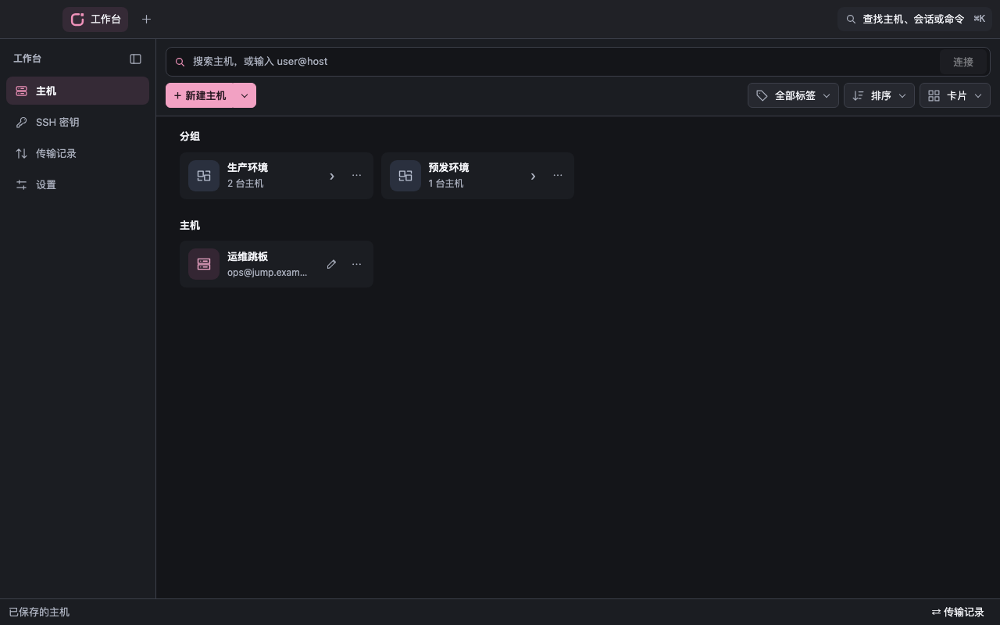
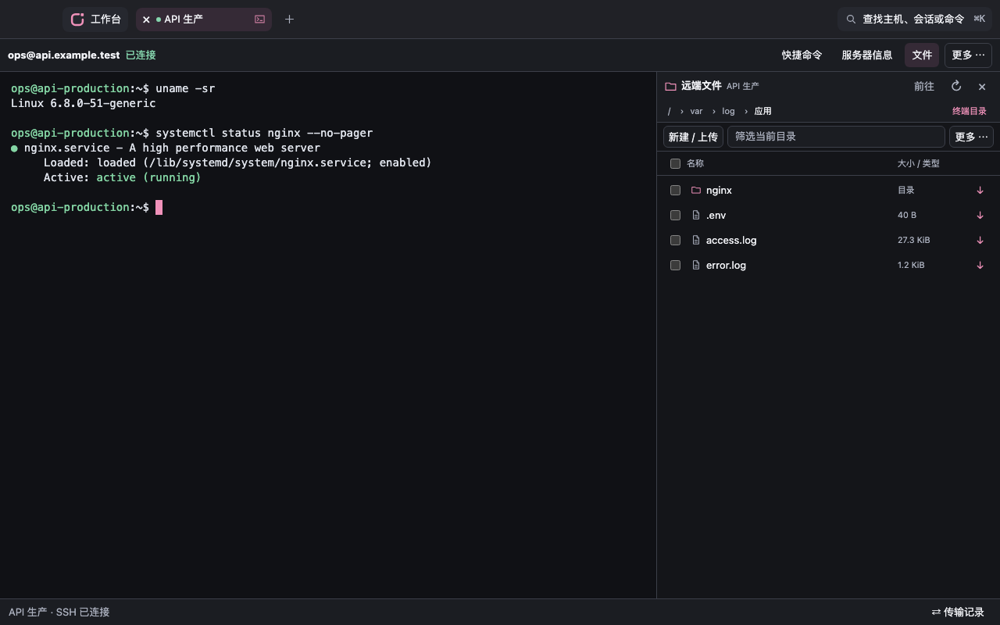
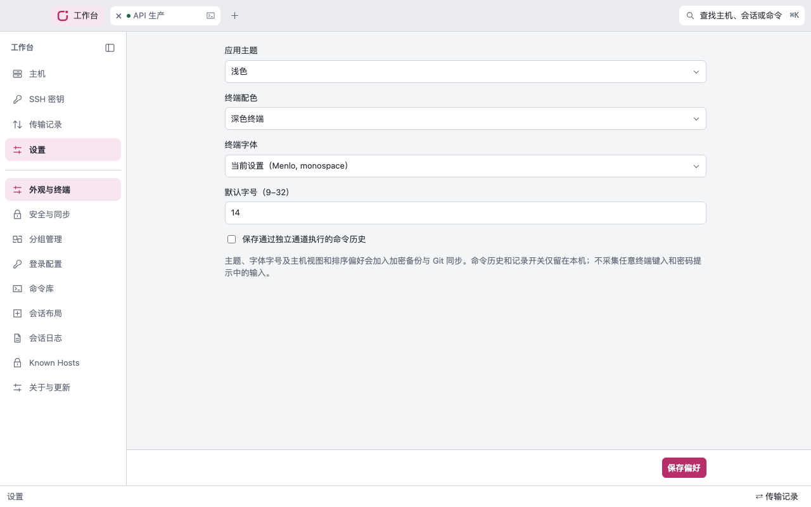

# Termlume

<picture>
  <source media="(prefers-color-scheme: dark)" srcset="assets/brand/logo-on-dark.svg">
  
</picture>

[English](README.md) | **简体中文**

Termlume 是面向 macOS 和 Windows 的桌面 SSH 工作台，将主机管理、多标签与分屏终端、SFTP 文件传输和服务器监控放在同一个窗口中。工作区保存在本机，也可选择加密备份，并通过自己的私有 Git 仓库在设备间同步。

[下载应用](https://github.com/ingot-cloud/termlume/releases/latest) · [全部版本](https://github.com/ingot-cloud/termlume/releases) · [反馈问题](https://github.com/ingot-cloud/termlume/issues) · [相关文档](#相关文档)

**产品介绍视频**（57 秒） · [下载 1080p 原片](docs/assets/termlume-intro.mp4?raw=true)

https://github.com/user-attachments/assets/7d1508ec-2bad-4319-ac6d-3c3f4bbb2834

- [主要功能](#主要功能)
- [主要页面](#主要页面)
- [安装与开始使用](#安装与开始使用)
- [安全与同步](#安全与同步)
- [常用快捷键](#常用快捷键)
- [从源码运行](#从源码运行)
- [开发与文档](#开发与文档)
- [开源协议](#开源协议)

## 主要功能

| 功能 | 当前支持 |
| --- | --- |
| 主机与分组 | 多级分组，卡片、列表与树形视图，搜索与标签筛选，按名称、最近连接或自定义顺序排列；复用登录配置，继承分组默认设置。 |
| SSH 连接 | 密码、本机私钥和 SSH Agent 认证，直连或单跳跳板机，服务器指纹校验，保活、超时与可选自动重连。 |
| 终端工作区 | 多标签会话，拖拽标签或窗格创建和调整分屏，保存会话布局，查找终端输出，自定义终端配色、字体与字号；恢复布局后，可点击「连接全部」，也可单独连接各窗格。 |
| SFTP 与远端编辑 | 文件与目录上传下载、重命名和删除，拖入本机文件上传；在文件面板双击文件名或聚焦文件名后按 Enter，可打开不超过 4 MiB 的普通 UTF-8 文本，默认全屏只读预览并按格式高亮。点「编辑」修改，保存或取消后回到同一文件的预览。遇到保存冲突时，可并排对比远端版本并调整草稿。「前往」可筛选此主机的收藏目录和最近目录。超过 4 MiB 的日志可直接查看最后 200 行或实时跟踪。顶部工具栏支持查找替换、跳行和自动换行。可对支持的格式进行本地排版，保存后写回远端，也可使用外部编辑器并确认回传。 |
| 端口转发 | 保存并手动启停本地、远程与动态 SOCKS5 转发规则，复用跳板路径；本地和动态转发仅监听 `127.0.0.1`。 |
| 命令与日志 | 保存常用命令，通过全局查找调用，可选启用主机启动命令，查看和跟踪远端日志，按需录制本机会话输出。 |
| 服务器信息 | 查看系统、CPU、内存、网络、存储和磁盘 I/O 指标及最近五分钟曲线；面板显示时每五秒刷新，可用指标取决于远端 Linux 或 macOS 系统。 |
| 加密工作区 | 本机数据加密，可选主密码与应用锁，导出加密备份，使用恢复密钥解锁；支持的 Mac 可启用触控 ID。 |
| Git 同步 | 通过私有 Git 仓库，以 SSH 或 HTTPS 同步主机、分组、登录配置、命令、布局和共享外观偏好；逐条解决冲突，可选自动同步。 |
| 导入导出与更新 | 导入 OpenSSH 主机配置和 CSV，将主机与分组导出为 CSV，在设置中检查并安装经过更新签名校验的应用版本。 |

## 主要页面

| 页面 | 用途 |
| --- | --- |
| 主机 | 浏览分组和主机，搜索、导入导出，编辑连接设置，打开 SSH 会话。 |
| 会话工作区 | 使用终端标签与分屏，打开当前会话的文件面板、远端编辑器、服务器信息、命令工具和端口转发。 |
| SSH 密钥 | 扫描或导入本机密钥，生成 Ed25519/RSA/ECDSA 密钥，查看公钥与指纹，将密钥加入已有 SSH Agent。 |
| 传输记录 | 「进行中」和「历史记录」分别按文件名搜索、按上传或下载筛选。文件及目录传输可暂停，在重连或重启后校验断点并继续。每条记录均可连接原主机并在 SFTP 中定位项目，也可打开本地目录并选中项目。支持重试失败任务、清空全部传输历史。 |
| 设置 | 管理外观、分组、登录配置、命令库、会话布局、会话日志、Known Hosts、安全与 Git 同步，以及应用更新。 |

### 主机



### 终端与 SFTP



### 设置



截图由当前界面生成，使用虚构主机和模拟会话数据；图中界面文字为中文。

## 安装与开始使用

前往 [GitHub Releases](https://github.com/ingot-cloud/termlume/releases/latest) 下载对应平台的安装包。

| 平台 | 安装包 | 安装方式 |
| --- | --- | --- |
| macOS · Apple Silicon | `Termlume-<version>-macOS-arm64-offline.zip` | 解压，将 `Termlume.app` 移入「应用程序」后打开。 |
| Windows · x64 | `Termlume-<version>-Windows-x64-setup.exe` 或 `Termlume-<version>-Windows-x64-offline.zip` | 运行安装器；ZIP 内包含同一安装器和说明，不是便携版。 |

GitHub 自动提供的 **Source code** 压缩包是源码，不能直接作为应用运行。目前提供的安装包面向 macOS Apple Silicon 和 Windows x64。

安装包内置界面资源和 Git 工具，Windows 还包含 OpenSSH 与完整 WebView2 离线安装器。普通用户无需安装 Node.js、Rust 或开发工具。安装、启动和本地工作区管理可离线使用；SSH、SFTP、Git 同步和检查更新需要能够访问对应服务器。详见[离线安装与运行](docs/OFFLINE_DISTRIBUTION.md)。

当前 macOS 包使用临时签名，尚未经过 Apple 公证；Windows 包尚无 Authenticode 发布者签名。应用更新包另有独立的更新签名校验。详见[自动打包](docs/GITHUB_RELEASES.md)与 [App 内更新](docs/APP_UPDATES.md)。

1. 新建主机，填写地址、端口、用户名和认证方式，或从 OpenSSH 配置、CSV 导入已有主机。
2. 打开主机，核对服务器指纹后认证。需要跳板机时，先保存跳板主机，再在目标主机的「更多设置」中选择连接路径。
3. 从会话工具栏打开文件、服务器信息或命令工具，拖拽标签和窗格安排工作区。
4. 在「设置 → 安全与同步」启用主密码、保存恢复密钥，按需导出加密备份或绑定私有 Git 仓库。

后续可在「设置 → 关于与更新」检查新版本。

## 安全与同步

- 本机工作区使用 XChaCha20-Poly1305 加密。需要打开工作区前验证身份时，可启用主密码与应用锁；关闭应用锁时，本机可自动解锁。
- SSH 密码与私钥口令默认仅存本机。只有主动选择共享的 SSH 密码会进入加密备份和 Git 快照；私钥文件、本机密钥路径、私钥口令、Git Token 与主机信任记录由各设备分别保存。
- Git 同步使用自己的私有仓库，默认分支为 `termlume-vault`。先启用主密码保护，再绑定仓库；另一台设备可在空工作区使用同一仓库及原主密码或恢复密钥恢复。
- 自动同步为可选功能，仅在应用运行且未锁定时执行；冲突可逐条处理。共用同一保险库的设备应使用兼容的应用版本。
- 会话录制默认关闭；主动录制的输出以明文保存在本机，与传输记录、命令历史一样不进入 Git 同步。CSV 导出也为明文，不包含密码、私钥和信任记录。

## 常用快捷键

| 操作 | macOS | Windows |
| --- | --- | --- |
| 查找主机、会话、命令和布局 | `⌘K` | `Ctrl+K` |
| 新建 / 关闭当前标签 | `⌘T` / `⌘W` | `Ctrl+T` / `Ctrl+W` |
| 查找已打开的会话 | `⌘J` | `Ctrl+J` |
| 查找终端输出 | `⌘F` | `Ctrl+F` |
| 切换文件面板 / 工作台导航 | `⌘E` / `⌘B` | `Ctrl+E` / `Ctrl+B` |
| 切换到第 1–9 个工作区标签 | `⌘1–9` | `Ctrl+1–9` |
| 终端字号增大 / 缩小 / 重置 | `⌘+` / `⌘-` / `⌘0` | `Ctrl++` / `Ctrl+-` / `Ctrl+0` |
| 保存内置编辑器文件 | `⌘S` | `Ctrl+S` |
| 格式化当前文件 | `⇧⌥F` | `Shift+Alt+F` |
| 编辑器内查找替换 | `⌘F` | `Ctrl+F` |
| 跳转到行 | `Ctrl+G` | `Ctrl+G` |

Windows 终端中，选中文字后 `Ctrl+C` 复制，无选中文字时发送中断；多行粘贴前会要求确认。

## 从源码运行

当前桌面应用使用 **Tauri 2、Rust、JavaScript、xterm.js 和 CodeMirror**。

### 环境准备

- Git、**Node.js 22.12 或更新版本**、npm，以及当前稳定版 Rust 工具链；终端中须能调用 Cargo。
- **macOS Apple Silicon：**安装 Xcode Command Line Tools（`xcode-select --install`）。当前内置 Git 的准备脚本要求使用 arm64 Mac。
- **Windows x64：**安装 Microsoft C++ Build Tools，勾选「使用 C++ 的桌面开发」和 Windows SDK；使用 `x86_64-pc-windows-msvc` Rust 工具链，并为开发环境安装 WebView2 Runtime。平台配置可参考 [Tauri 环境准备](https://v2.tauri.app/start/prerequisites/)。

### 下载并启动

```sh
git clone https://github.com/ingot-cloud/termlume.git
cd termlume
npm ci
npm start
```

已经下载源码时，在项目根目录执行最后两条命令即可。`npm start` 启动原生 Tauri 开发应用，与 `npm run tauri:dev` 等效。首次运行会下载依赖并准备平台内置工具，需要网络和较长的构建时间。开发启动与正式构建前均会自动生成前端资源。

### 构建本机应用

在 macOS Apple Silicon 上运行：

```sh
npm run tauri:build -- --bundles app --ci -- --locked
codesign --force --sign - 'src-tauri/target/release/bundle/macos/Termlume.app'
codesign --verify --deep --strict 'src-tauri/target/release/bundle/macos/Termlume.app'
```

应用输出到 `src-tauri/target/release/bundle/macos/Termlume.app`。上述命令沿用项目当前的临时签名方式；已有 Developer ID 证书时，可使用 `npm run tauri:build:signed`，并参考[发版操作规范](docs/RELEASE_PLAYBOOK.md)。

在 Windows x64 的 PowerShell 中运行：

```powershell
$env:RUSTFLAGS = "-C target-feature=+crt-static"
npm run tauri:build -- --target x86_64-pc-windows-msvc --bundles nsis --ci -- --locked
```

安装器输出到 `src-tauri/target/x86_64-pc-windows-msvc/release/bundle/nsis/`。构建钩子会自动准备固定版本的 Git、OpenSSH 和 WebView2 资源。可分发压缩包、摘要与更新产物的生成方式见 [GitHub Release 自动打包](docs/GITHUB_RELEASES.md)。

## 开发与文档

### 检查命令

```sh
npm test
npm run test:ui
```

界面回归使用 Google Chrome 与隔离的虚构数据。macOS 默认使用 `/Applications/Google Chrome.app`，其他安装位置可通过 `TERMLUME_TEST_CHROME` 指定 Chrome 可执行文件。

原生 Rust 单元测试需先准备资源：

```sh
node scripts/tauri-before-build.cjs
cargo test --locked --release --manifest-path src-tauri/Cargo.toml --lib
```

macOS 还可运行 `npm run tauri:test:macos`，使用本机回环地址上的临时 SSH、SFTP 与 Git 服务执行集成回归。

### 源码目录

| 路径 | 内容 |
| --- | --- |
| `src/ui/` | 共享桌面界面、终端、文件编辑器与工作区交互。 |
| `src-tauri/` | Rust 后端、原生能力与 Tauri 打包配置。 |
| `scripts/` | 资源准备、平台依赖、检查与发版工具。 |
| `test/` | Node.js 回归测试。 |
| `docs/` | 兼容性、分发、更新与验收文档。 |
| `assets/brand/` | Logo、应用图标与品牌资源。 |

仓库仍保留 Electron 原型（`npm run electron:dev`）；当前功能与工作区格式以 Tauri 应用为准。

### 相关文档

详细项目文档目前以中文维护。

| 文档 | 内容 |
| --- | --- |
| [产品规划与跟进](PRODUCT_PLAN.md) | 功能状态、后续规划与验收条件。 |
| [工作台交互规范](WORKSPACE_UX.md) | 主机、会话、文件、命令和工作区行为。 |
| [视觉与组件规范](STYLE_GUIDE.md) | 主题、设计变量、组件与视觉验收。 |
| [统一验收清单](docs/UNIFIED_ACCEPTANCE.md) | 人工检查步骤与已知验证边界。 |
| [Windows 兼容性审计](docs/WINDOWS_COMPATIBILITY.md) | Windows 专属能力与验证说明。 |
| [离线安装与运行](docs/OFFLINE_DISTRIBUTION.md) | 内置依赖、来源与离线使用范围。 |
| [发版操作规范](docs/RELEASE_PLAYBOOK.md) | 版本管理、发版核验与本机升级验收。 |
| [GitHub Release 自动打包](docs/GITHUB_RELEASES.md) | CI 工作流、安装包、签名与校验文件。 |
| [App 内更新](docs/APP_UPDATES.md) | 更新签名、安装流程与兼容性。 |

欢迎通过 [Issues](https://github.com/ingot-cloud/termlume/issues) 反馈问题和提出建议。贡献代码时请遵循 [AGENTS.md](AGENTS.md)，执行相关检查，并使用 Conventional Commits，例如 `fix(ssh): 修正重连超时`。

## 开源协议

Termlume 采用 [Apache-2.0 license](https://github.com/ingot-cloud/ingot#Apache-2.0-1-ov-file) 开源协议。内置第三方组件保留各自的许可证与声明。
