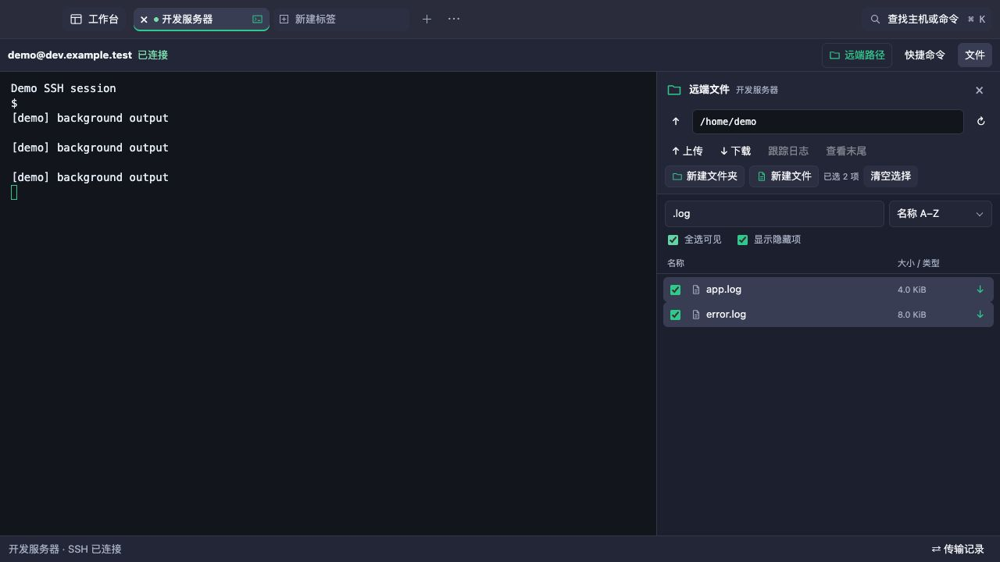

# Termlume 视觉与组件规范

当前基线：2026 年 11 月 15 日，macOS 深浅主题桌面工作台。面向长时间连接服务器的工作场景，本轮以 Terminus / Tabby 的工作台层次为视觉方向，使用分层深灰背景、浅色文字、粉色操作焦点和紧凑工具栏。资源卡片保留清楚的名称、连接信息和独立编辑入口；会话全宽，设置独立成页。

实现入口是 [style.css](src/ui/style.css) 中的 `:root` 变量和组件规则；终端通过 [renderer.js](src/ui/renderer.js) 的 `attachTerminal` 读取共享颜色。产品范围、状态和后续任务以 [PRODUCT_PLAN.md](PRODUCT_PLAN.md) 为准；操作行为以 [WORKSPACE_UX.md](WORKSPACE_UX.md) 为准。修改组件时同时维护对应规范及验收记录。

## 品牌标志

品牌正式采用用户选定的 A2「光门」与 A「石墨玫粉」主题。开放门框与浮起的光点组成标志，使用中性石墨灰、玫粉色和浅色字标。矢量 Logo、深浅背景版本、App 图标母版及再生成方式见 [品牌资源](assets/brand/README.md)。顶部工作台入口使用 20 px 光门，跟随主题强调色；App 图标采用近黑色圆角底和柔和粉色光感。浅色模式使用冷白表面、浅灰画布与深玫粉强调色，成功、警示、错误继续使用绿色、琥珀色、红色。

## 与 Terminus / Tabby 的对齐范围

本轮依据用户指定的 Terminus / Tabby 方向，在现有组件上收敛深灰层次、常驻导航、标签与克制控件。以下颜色和尺寸是 Termlume 的实现值，不代表参考产品的官方设计令牌。此前 Termius 截图保留为历史实现证据，本轮不据此声明新的视觉验收已通过。

| 方面 | Termlume 的落实方式 |
| --- | --- |
| 背景层级 | 深色内容区、稍亮的导航/卡片、抬高的菜单/弹窗和选中填充，使用同一组变量 |
| 操作强调 | 粉色用于焦点、选择边框、当前导航和可操作入口；深色模式主按钮采用柔粉底与近黑文字，浅色模式采用深玫瑰底与浅色文字 |
| 资源识别 | 主机和密钥使用玫瑰色图标块，分组使用灰蓝色图标块；图标表示资源类型，操作系统识别另行规划 |
| 资源布局 | 60 px 卡片，主机名称加一行连接地址、自适应列数；名称和地址截断时保留完整悬浮说明 |
| 分组树 | 主机与设置复用紧凑树行、28 px 资源图标、旋转展开箭头及名称/辅助信息；每层缩进 16 px，深层缩进最多 128 px，窄窗口保留名称与操作可达；设置行的子组/编辑/删除按钮按宽度换行 |
| 编辑表单 | 右侧抽屉滑入/滑出，地址、常规、SSH 连接分区，固定底部操作；继续使用显式「保存」「保存并连接」和草稿退出确认 |
| 浮层 | 菜单、下拉和对话框共享底色与细边框，不使用外投影；高亮、勾选、键盘焦点分别可辨 |
| 终端与文件 | 会话页隐藏侧栏，由顶部标签切换工作台和会话；工具栏只保留常用入口，文件侧栏跟随会话，窄窗口转为底部抽屉 |
| 主题范围 | 提供深色/浅色/跟随系统；终端深浅配色独立设置，主机或分组可覆盖 |

密钥页的来源切换、搜索和生成操作合并在同一工具栏；传输页仅保留筛选和清理操作。新建标签页的搜索和新建主机操作同行排列。没有操作的页面不保留空标题栏或占位分隔线。

## 颜色变量

新增颜色先确认是否属于以下语义。文字、焦点、菜单和资源图标优先引用变量；终端 ANSI 色板及搜索高亮可以有专用颜色。

| 变量 | 当前值 | 用途 |
| --- | --- | --- |
| `--bg` | `#141519` | 主内容区、抽屉底色 |
| `--chrome` | `#202126` | 原生窗口顶部工作区 |
| `--bar` | `#1b1d22` | 侧栏、工具栏、资源卡片、表单分区 |
| `--raise` | `#26282f` | 菜单、普通弹窗、抬高的控件 |
| `--surface-hover` | `#2d3038` | 资源悬浮、下拉触发器悬浮 |
| `--selected` | `#352a36` | 选中填充、导航和标签激活 |
| `--border` | `#3c3f49` | 分隔线、字段边框、普通面板轮廓 |
| `--text` | `#f2f3f7` | 标题、正文和按钮文字 |
| `--muted` | `#abb0be` | 地址、说明、辅助文字、占位提示 |
| `--accent` | `#f092ba` | 焦点环、选择边框、链接、当前入口、终端光标 |
| `--accent-soft` | `#f092ba1c` | 轻量强调背景和未读提示底色 |
| `--success` | `#86d6ae` | 已连接、完成等成功状态 |
| `--warning` | `#eac887` | 等待指纹核对等需要关注的状态 |
| `--danger` | `#f6a5aa` | 错误、失败、删除动作 |
| `--danger-soft` | `#f6a5aa18` | 危险动作悬浮背景 |
| `--primary` | `#f2a1c3` | 主按钮底色 |
| `--primary-text` | `#261720` | 主按钮文字色 |
| `--primary-active` | `#e98eb5` | 主按钮按下底色 |
| `--primary-hover` | `#f7b6d1` | 主按钮悬浮底色 |
| `--primary-border` | `#f2a1c3` | 主按钮及展开控件的强调边框 |
| `--resource-fg` / `--resource-bg` | `#f2aacb` / `#342633` | 主机和密钥图标 |
| `--group-fg` / `--group-bg` | `#bcc3d4` / `#2a303e` | 分组图标 |
| `--terminal` / `--terminal-text` | `#101115` / `#dfe3eb` | 终端背景及默认文字 |
| `--terminal-selection` | `#493345` | 终端文本选区 |

焦点色与成功色分别表达操作位置和执行结果。活动标签的底色和文字表示当前标签，旁边状态点表示会话状态；独立的「新」标记表示未读输出。失败同时提供文本说明，颜色不承担唯一的信息表达。

本轮校验了主文字、辅助文字、强调色和三种状态色在 `--bg`、`--bar`、`--raise`、`--selected` 四个底色上的对比度，均达到 4.5:1。更改颜色后重新检查这些组合；透明叠加、终端 ANSI 内容、禁用控件及图片需按具体使用方式另行检查。

## 字体与尺寸

| 项目 | 基线 |
| --- | --- |
| 界面字体 | macOS 系统无衬线字体，回退到 BlinkMacSystemFont、sans-serif |
| 正文 | 13 px，行高 1.5 |
| 辅助信息 | 11–12 px；主机与密钥卡片的第二行固定 12 px |
| 页面标识 | 使用侧栏、顶部标签和可访问区域名称，不显示重复页标题及说明；普通对话框标题 16 px |
| 终端 | SFMono-Regular、Menlo、monospace，初始 14 px、行高 1.2；保留用户会话中的字号操作 |
| 顶部栏 | 50 px；macOS 左侧留出窗口控制区，三个原生窗口按钮与标签行垂直居中 |
| 设置内容 | 主区域内居中，最大宽 760 px；表单、安全配置分区和底部操作使用相同内容边界，窄窗口按可用宽度收缩 |
| 导航 | 宽 200 px，收起为 54 px；窄窗口宽 136 px；导航项至少 36 px 高 |
| 资源卡片 | 约 60 px 高。分组和主机卡片按可用宽度排列，最小列宽 240 px，空间不足时单列铺满 |
| 主机列表 | 分组在上、主机在下，两个分区一起滚动。列表视图在宽屏将主机名称和连接信息横向排列，行高约 40 px；窄窗口使用两行信息 |
| 资源图标 | 卡片 40 px，列表 28 px；通用线性图标约 17 px |
| 表单字段 | `--control-height: 36px`；输入框与下拉统一高度 |
| 工具栏控件 | 常规约 32 px，紧凑操作至少 `--control-compact: 28px` |
| 右侧编辑抽屉 | 宽 480 px；窗口不足时按可用宽度收缩，内容独立滚动 |
| 文件侧栏 | 宽度约 310–440 px，820 px 及以下转为底部抽屉。导航、筛选和操作各占一行或收进菜单，文件列表占满余下高度 |
| 文件编辑器 | 默认宽 900 px，可拖动标题栏和右下角调整位置与大小，浮窗保持在应用可用区域内；全屏时顶部留出原生标题栏高度，正文独立滚动，底部保留保存和下载 |

终端按内边距和分屏标题下方的可用区域计算行数。最后一行与底部状态栏保持间距，不足一行的底部余量与该会话的终端配色同色；不同主机分别使用深浅配色时也应保持一致。文件编辑器使用应用的深浅主题，语法颜色区分关键字、字符串、数值、名称及注释。

主要布局间距优先使用 4、8、12、16、24、32 px，对应 `--space-1` 到 `--space-6`。图标、表格、边框和紧凑工具栏允许必要的光学校正。表单按分区组织，标题、说明、输入和操作之间保留稳定间距。

弹窗、抽屉和文件编辑器通过统一浮层限制内容区交互，遮罩从标题栏下方开始。标题栏始终保留窗口拖动、双击缩放与原生窗口按钮；浮层打开时禁止切换背景标签。多层浮层只允许操作最上层，关闭后恢复下层焦点，Tab 在当前浮层内循环，Escape 先收起下拉选择。

圆角通过变量维护：字段/按钮 6 px、导航等条目 8 px、菜单 10 px、面板/对话框 12 px、资源卡片 8 px。小徽标和图标块可使用更小的专用圆角。

## 组件状态

| 组件 | 默认、悬浮、选中与焦点 |
| --- | --- |
| 主按钮 | 主题主色底、独立文字色和清楚边框；悬浮抬高亮度；同一操作区只突出一个主要动作 |
| 次按钮 | 透明或面板底色，按场景保留细边框；悬浮使用选中底色 |
| 危险按钮 | 保留具体动作名称，使用危险文字色和浅危险悬浮底色；删除确认规则见交互规范 |
| 禁用 | 原生禁用状态与降低透明度；请求进行时保留原标签并防止重复提交 |
| 输入与下拉 | 细边框、统一高度；鼠标点击及下拉展开保持原边框，只有键盘导航显示 2 px 粉色焦点轮廓；校验错误使用危险色及文字提示 |
| 主机、分组、密钥 | 悬浮抬高底色；选中保留粉色边框和选中填充；焦点轮廓与选中状态均可辨 |
| 会话标签 | 切换时改变填充和文字，保持宽度稳定；长名称使用省略和完整标题 |
| 标签状态点 | 已连接为成功色；连接中/运行中为强调色；等待指纹为警示色；失败为危险色；断开为辅助色 |
| 下拉菜单 | 已选项显示勾选；方向键高亮显示选中底色和粉色左标；不可选项降低透明度 |
| 上下文菜单 | 与下拉共享浮层色、圆角和细边框，不使用外投影；菜单项至少 36 px 高，支持键盘焦点 |
| 对话框与抽屉 | 标题和操作位置固定；较长内容在内部滚动；错误在表单内显示 |
| 文件列表 | 目录优先，悬浮与多选行可辨；操作图标与名称分开；文件名完整值保留在可访问名称中 |
| 进度与结果 | 进度条配合状态文字；完成、失败、待确认分别可辨，具体目标和错误保留在任务行 |
| 空状态 | 中性色图标、明确原因和可执行入口；搜索无结果与尚无资料分别说明 |

菜单与弹窗使用 `--popup-shadow`，遮罩使用 `--backdrop`。滚动条采用细轨道并保留可发现的滑块。文件抽屉及主机编辑抽屉具有开合动画，遵循 `prefers-reduced-motion`；主题和选中状态变化不改变控件尺寸。

## 页面参考

以下为 U-002 之前的历史截图，颜色、导航及工具栏位置以当前代码与文末规范为准。图片来自本地模拟数据界面，不包含实际服务器、凭据或用户资料。

主机页的卡片、选择边框、紧凑工具栏和灰色主按钮：

右侧编辑抽屉的分区、字段和固定操作：

会话与文件工具区的层级、字体和多选状态：

最小窗口的文件抽屉见 [550 × 490 参考图](docs/assets/session-files-compact.jpg)。

单跳连接沿用表单下拉和等待指纹的状态样式；连接路径显示「直连」或「经 主机名称 · 端点」，工具栏保留跳板名称。指纹提示用文字区分跳板和目标，不增加新的颜色语义。新增参考图：[路径下拉](docs/assets/jump-host-editor.jpg)、[跳板指纹确认](docs/assets/jump-host-trust.jpg)，均为模拟数据。550 × 490 下字段可滚动，底部操作保持可见。

本地端口转发面板沿用普通对话框、`--bar` 分区、边框与危险状态文字。规则行同时显示名称、完整映射、会话状态和操作；错误与“监听中”分别表达目标连接结果和本地监听状态。按钮允许换行，地址允许断行，使用既有颜色变量，不新增独立主题。本批已补查三类转发字段方向、动态禁用状态及 550 × 490 窗口。普通管理对话框现固定标题和底部操作，内容单独滚动；原生窗口键盘验收仍归 Q-001。模拟证据见文末统一清单。

## 视觉验收与维护

- 主机页、列表视图、密钥、安全与同步、传输记录、主机编辑器、菜单和文件侧栏使用相同的颜色与状态语义。
- 在常用桌面窗口及最小窗口 550 × 490 下检查：标题、按钮、表单错误和当前目标可见；内部内容可滚动；页面不出现横向溢出。
- 检查空状态、悬浮、选择、键盘焦点、禁用、错误、等待认证及未读提示。选中和未选中标签宽度一致。
- 在终端中检查普通输出、ANSI 颜色、光标、选区和查找高亮；保留全屏程序及中文输入的既有行为。
- 修改共享颜色时校验文字对比度；修改组件尺寸时走查窄窗口，必要时更新本页参考图。
- 前端资源通过 `npm run tauri:assets` 生成；macOS 构建与签名按 [README](README.md) 执行。样式走查不能代替真实 SSH、SFTP、钥匙串和双设备同步验收。

本基线对应产品跟进项 `S-001`。本轮已完成模拟视觉走查、颜色对比度、40 px 宽屏列表、174 px 标签宽度稳定性和 550 × 490 布局检查；原生窗口与真实环境验证保留在 `Q-001`。浅色主题和终端偏好 `S-002` 已实现，原生验收归入本批统一清单。

## S-002 与本批组件补充

应用浅色主题使用 `:root[data-theme="light"]` 覆盖语义变量并声明 `color-scheme: light`；系统主题只切换主题，不改会话字号。终端配色由 xterm 独立设置 ANSI、前景、背景、光标、选区，主机/分组覆盖优先；切换应用主题不隐式改变终端内容配色。

| 语义 | 深色 | 浅色 |
| --- | --- | --- |
| 内容/侧栏/浮层 | `#141217` / `#1c181f` / `#28212b` | `#faf5f8` / `#ffffff` / `#fffafd` |
| 文字/辅助 | `#f8edf4` / `#bbafbe` | `#2d2230` / `#6e5b6b` |
| 焦点/选中 | `#f58cb8` / `#382b38` | `#ac356b` / `#eedce8` |
| 终端背景/文字 | `#100f13` / `#f1e8ef` | `#fff9fc` / `#2d2230` |

身份、分组、命令、布局、日志、信任和外部编辑副本管理沿用同一对话框、资源分区和操作行。长命令、路径及逐项结果采用可滚动等宽区；命令编辑器为 textarea，使用字段背景/边框/圆角。继承字段使用原生 disabled 并同步自定义下拉状态，辅助文字同时说明来源和生效值。秘密不进入列表或 Git 冲突摘要。

所有分屏每屏顶部留出 32 px 操作区，包含名称和移出按钮，聚焦屏使用粉色边框。9 px 分隔条支持拖动、键盘与双击均分，展示可访问的方向与 20–80% 数值；树形布局的每条分隔条独立调整对应分支，关闭窗格后合并空分支。比例变化后各屏重新拟合终端尺寸。规则面板按类型显示本机/远端监听位置，禁用无关字段，状态/错误各自保留。

分屏在顶部合并为一个「工作区」标签，屏数以强调色徽标显示，保存布局按钮仅在分屏工作区的终端工具栏出现；各窗格标题可单独拖动。可拖动的标签和窗格标题使用 `grab` 光标，超过 6 px 后全局改为 `grabbing`，清除并禁止文本选择，同时显示小型拖动副本；标签栏插入线使用 `--accent`。落点预览固定在当前目标窗格的对应半区，组内移动不按移除源窗格后的布局提前重排，内缩 5 px、10 px 圆角、1 px 强调色边框，底色采用约 32% 强调色混合，保持底层终端可见。不设屏数上限，仅空间不足时使用危险色并显示原因。中央小区域不提供替换；拖回顶部栏任意位置，以 174×30 px 的半透明标签占位及对齐标签行的浮动标签提示拆出；原窗格透明度降为 40%，取消或松手后恢复。预览不拦截命中，取消后立即清理，深浅主题共享语义变量。

分屏只通过拖拽建立；移除分屏设置面板及工具栏中的分屏入口；保存布局位于工具栏操作区最左端，远端路径输入收进「更多」。默认居中窗口为 1280×800，小屏按系统工作区域减去 48 px 收缩，最小 550×490。

其他主机、会话和可增长的关联资源选择使用同一搜索下拉。搜索词按空格分开匹配名称、地址、分组和标签；筛选项按场景提供分组、来源、认证方式或状态，提示文案与场景一致。已选主机下方显示地址和分组。新建标签、会话切换和快捷查找使用可换行的筛选栏，提供重置筛选，结果行根据内容自然增高，避免小窗口截断连接资料。

本批模拟界面和测试证据见 [统一验收清单](docs/UNIFIED_ACCEPTANCE.md)。模拟界面证据不代表 macOS 原生窗口、外部编辑器或真实双设备验收通过。

本批参考图：

[550 × 490 转发表单与固定操作栏（模拟数据）](docs/assets/forwards-batch-compact.png)。

深浅两套主题的正文、辅助、焦点和成功/警示/错误文字，在内容、侧栏、浮层、选中背景上的 24 组组合均检查为至少 4.5:1；浅色焦点已加深以满足选中背景上的对比。

## U-002 工作台组件补充

U-003 更新：侧栏仅在工作台页面显示主要导航和设置分类，Git 同步入口位于「设置 → 安全与同步」；移除重复的会话/分组区域及工具浮层。设置分类与列表、表单、日志详情均在独立设置页中显示，不保留独立页标题区，底部保存操作固定，内容单独滚动，列表新增操作并入内容区。会话与新标签页隐藏侧栏，顶部「工作台」文字在窄窗口仍保留。窄导航减小间距，操作文字保持单行；长资源名称使用省略并保留 title。

按钮允许按可用宽度自然换行，操作区随之增高，避免固定高度裁字。上下文菜单使用可收缩的单列网格，菜单项宽度填满、长文字换行，整体限制在窗口边界内。主机卡片与列表行始终保留独立铅笔编辑按钮和「⋯」菜单。

U-004：操作按钮与菜单使用完整动作文字，不在导入、编辑、身份、转发、恢复等标签末尾添加省略号。主机列表移除保存数量、选中说明和重复操作栏；首页列表直接接在工具栏下方，分组面包屑按需出现。

U-005：主机第二行只显示连接地址；编辑与更多按钮使用独立的 `--primary-hover` 底色和主文字色高亮，在已选卡片上也可辨。抽屉滑入 200 ms、滑出 180 ms，减少动态效果时关闭动画。主机内的私钥只显示名称；选择器为单列私钥列表，选中使用现有焦点色和勾选，底部主题色「确定」在「关闭」左侧，无管理工具或右侧详情。

工具栏「更多」与文件「所选项」「新建 / 上传…」复用原上下文菜单样式、键盘导航与窗口边界约束；禁用项目不进入方向键循环。文件面包屑允许横向滚动及名称省略，完整路径保留 title；当前目录同时使用文字亮度和 `aria-current` 区分。命令搜索按类型分区，每项同时显示名称与目标，面板中明确目标端点。

2026 年 11 月 8 日已执行 U-003 深浅主题下 1140×740 与 550×490 浏览器检查：每个尺寸 31 项行为检查通过，所有可见按钮无内容溢出，页面无横向溢出；截图人工走查覆盖主机菜单、编辑抽屉、独立设置页和隐藏侧栏的会话。`npm run test:ui` 可复验并生成 `dist/ux-review/` 截图；真实原生窗口与两设备验收继续归 Q-001。

「安全与同步」直接从配置分区开始，内容单独滚动。设置卡片按依赖展开：主密码保护开启后显示应用锁、Git 和备份；关闭应用锁或暂停 Git 后收起各自的策略。即时开关在失败或取消时恢复，需编辑参数的策略用单独的保存按钮。同步失败和冲突用文字说明下一步。

## 服务器信息面板（2026 年 11 月 12 日）

「服务器信息」与文件区共用 310–440 px 侧栏，820 px 及以下转为底部面板。标题、当前主机、刷新与关闭固定；内容滚动。系统、CPU、内存、存储使用既有背景、边框与 6 px 圆角分区，字段为 12 px，标题为 13 px。占用条使用强调色，90% 及以上使用警示色，同时提供百分比与容量文字；缺失指标显示「暂不可用」。更新时间旁显示「每 5 秒自动刷新」，自动更新保留内容滚动位置。深浅主题共享语义变量，长主机名、型号与挂载路径均允许换行或省略。

网络分区优先显示默认路由网卡，其余放入「其他网卡」原生折叠区，刷新保留展开状态；每个网卡使用两列数值块分别显示「↓ 下行（接收）」与「↑ 上行（发送）」。速率使用强调色和 16 px 等宽数字特性，单位为 B/s、KiB/s、MiB/s 等；累计收发流量沿用 12 px 字段行和容量单位，零值与暂不可用分别表示。长网卡名称和数值可换行，分区继承深浅主题变量，自动刷新保留滚动位置。

网络实时曲线使用自适应 SVG，图高 112 px，速度纵轴在图外显示零值、中间值和共享上限，时间横轴为「5 分钟前 / 现在」。下行沿用 `--accent` 实线，上行使用 `--network-upload` 虚线（深色 `#9bc4ff`、浅色 `#2563a6`），同时提供文字图例；网格使用既有边框色。无数据时说明等待采样，有数据时显示采样点数，暂停和未知速率以断开的线段表示。曲线提供峰值与点数的可访问名称及逐点悬浮提示，深浅主题共用语义变量，窄侧栏内不横向溢出。

CPU、内存使用率曲线复用同一图形布局，各自放在占用条下方，使用 `--accent` 实线和「使用率」图例。纵轴固定为 100%、50%、0%，避免自动缩放放大微小波动；采样点提示及峰值均使用百分比。缺失值和暂停空档断开绘制，零使用率正常显示在基线。

「磁盘读写」沿用网络的双列速度数值块和自适应 SVG，每个块设备单独显示名称、读取/写入速度及曲线，设备之间用既有边框和间距分隔。读取使用强调色实线，写入使用蓝色虚线；图例明确标注「读取 / 写入」，共享自动速度刻度与 B/s、KiB/s、MiB/s 等单位。零活动显示基线，缺失值与暂停时段断开，继承深浅主题和窄面板布局。

每个磁盘的 IOPS 与 I/O 利用率使用双列数值块，后接两张纵向排列的单线曲线，沿用强调色实线与既有图例。IOPS 纵轴按十进制自动调整，单位为 IOPS、kIOPS 或 MIOPS；利用率纵轴固定 100%、50%、0%。无指标时明确显示暂不可用，曲线提示暂无有效采样，不绘制零值替代；自动刷新保留当前滚动位置。

平均读取/写入延迟沿用双列数值块和双曲线，读取为主题强调色实线、写入为蓝色虚线，共用 ms 刻度，允许小数。平均 I/O 队列长度使用整行数值块与主题强调色单曲线，单位为「个请求」，纵轴按十进制自动调整，不限制在 0–1。数值最多保留三位小数；正值小于 0.001 时显示「<0.001」，有效零值与缺失读数分别表示。未知和暂停时段断开曲线，无有效延迟时明确显示暂无有效延迟采样。

## A2 光门与黑粉主题补充（2026-11-13）

主按钮通过 `--primary-text` 与底色配对，悬浮/按下使用独立底色；主机编辑与更多按钮的浅粉悬浮态同步使用深色文字。主机和密钥使用玫瑰图标块，分组使用灰紫图标块；浅色模式提供对应的深色图形。终端的两套背景、文字、光标和选区在 CSS 定义，xterm 依据主机覆盖或终端偏好读取，切换应用主题不会改变独立的终端配色。ANSI 中绿色、红色等继续表达命令内容，紫红色调整为粉色。

新建主机默认收起分组继承与高级连接选项：分组为空时不显示继承项；选定或新建分组后集中显示端口、登录配置和配色开关、生效值及来源；跟随分组登录配置时隐藏单独 SSH 字段。连接区默认显示用户名和密码，私钥模式增加等宽选择框；密码与私钥口令共用遮掩和眼睛样式，认证切换置于凭据下方；连接路径与复用登录配置进入“更多设置”。此规则适用于 macOS 和 Windows。

## 命令库与快捷命令（2026-11-14）

命令库使用居中的设置内容宽度，搜索与新建按钮同行，滚动时工具栏固定。命令行显示名称、内置标记、可换行的等宽正文及操作；快捷状态同时以星标、文字和填充表达。上移、下移按钮提供完整可访问名称，窄窗口操作换行。

快捷命令使用同一套面板颜色。常用命令在上方以两列按钮展示，窄窗口转为单列；下方其他命令使用紧凑列表。两区共用搜索和滚动区域，保留明确的主机目标、键盘选择与命令库管理入口。

## 搜索与列表弹窗尺寸（2026-11-14）

搜索、选择和列表弹窗按窗口尺寸分配稳定的外框，不以结果数量决定宽高。通用列表弹窗最大 640×600 px，高度不超过标题栏下可用区域的 84%，窗口四周保留边距；搜索、标题和底部操作固定，结果区填满余下空间并独立滚动，预留滚动条位置。多条、单条、无匹配及异步加载共用同一外框。

会话切换保留最大 720×500 px，私钥选择保留最大 480×600 px，均遵循相同的窗口高度限制。可搜索下拉最大 640×380 px，根据触发控件上下可用空间定位；筛选时不因结果变少缩小或改换展开方向。简短确认框紧凑显示并遵守最大尺寸；抽屉和可调整的文件编辑器沿用各自受窗口边界约束的布局。

## 石墨玫粉与设置列表（2026-11-15）

采用用户选定的 A「石墨玫粉」。深色为中性石墨灰，浅色为 `#F4F5F7` 画布与 `#FFFFFF` 表面；粉色强调分别为 `#F092BA` / `#B62F69`。浅色主文字 `#242731`、辅助文字 `#626A78`、选中 `#F7E5EF`、边框 `#CFD3DC`。终端深浅底色分别为 `#101115` / `#FCFCFE`，继续保留独立终端偏好。正文、辅助、强调及状态文字在四类界面底色上的对比度至少 4.5:1。

设置中的集合页面采用同一行的左侧搜索、右侧操作。分组按名称和路径筛选并保留祖先层级；登录配置按名称、用户名及认证方式筛选；Known Hosts、日志详情将已有搜索与操作合并。窄窗口仍同行排列，保留搜索输入宽度。安全设置的单项操作使用左侧说明、右侧按钮。

「安全与同步 → 数据保护」提供修改主密码入口，可验证当前主密码或恢复密钥。只重新包装原数据密钥并原子保存，不重置工作区、主机、凭据、恢复密钥、应用锁或同步设置。新密码用于本机与之后生成的备份和同步快照；已有备份、旧快照与其他设备保留原密码。两步启用流程保留第一步确认的密码，不再依赖已移除的密码输入控件；每次进入新锁定状态默认使用主密码，避免遗留恢复密钥模式。

## 鼠标焦点与选中（2026-11-17）

菜单、SSH 密钥及主机页的主机和分组保留资源选中样式。其他输入框、按钮、下拉触发器、会话标签、分屏和选项不因鼠标点击增加选中边框；状态使用文字、填充或勾选。键盘导航显示焦点提示，切回鼠标操作时清除。浮动主机、分组、密钥创建与生成抽屉共用遮罩和草稿关闭确认，不改变后台布局。
