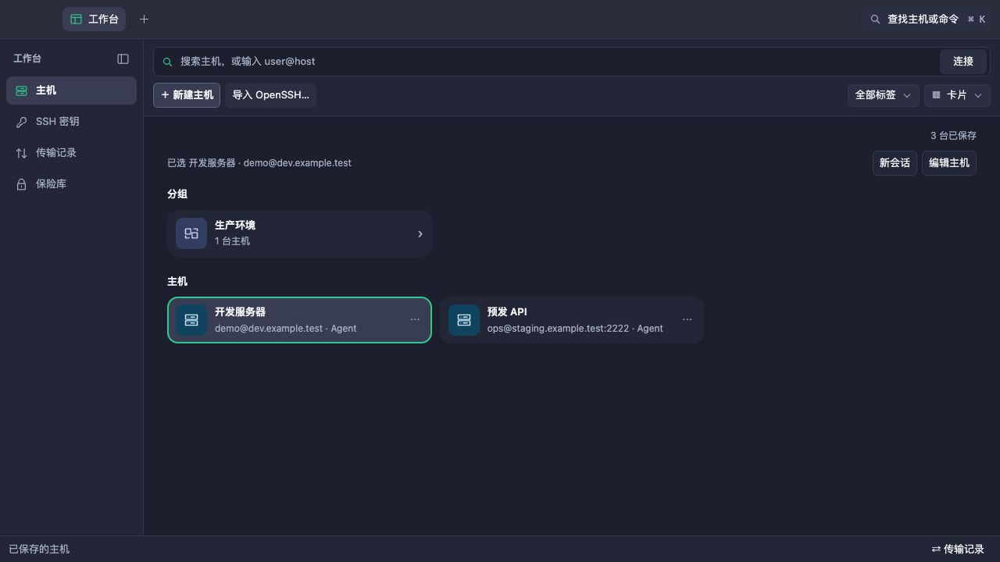
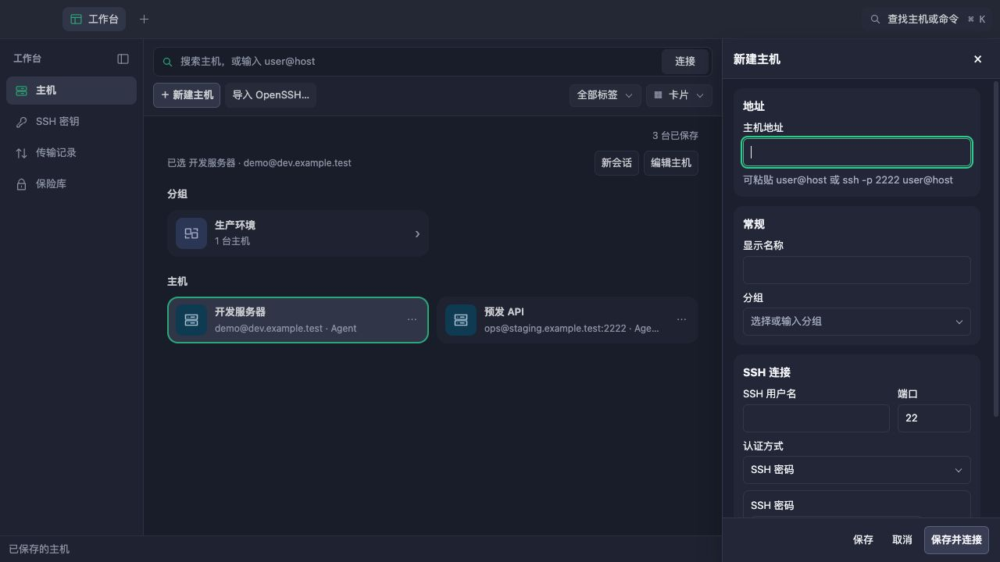
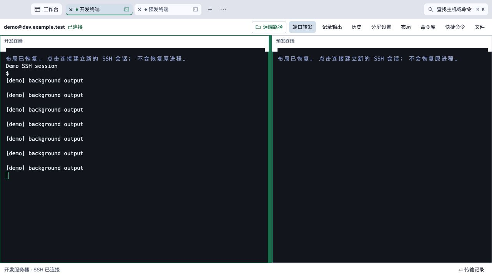

# Termlume 视觉与组件规范

当前基线：2026 年 11 月 7 日，macOS 深浅主题桌面工作台。面向长时间连接服务器的工作场景，本轮以 Terminus / Tabby 的工作台层次为视觉方向，使用分层深灰背景、浅色文字、绿色操作焦点和紧凑工具栏。资源卡片保留清楚的名称、连接信息和操作入口。

实现入口是 [style.css](src/ui/style.css) 中的 `:root` 变量和组件规则；终端通过 [renderer.js](src/ui/renderer.js) 的 `attachTerminal` 读取共享颜色。产品范围、状态和后续任务以 [PRODUCT_PLAN.md](PRODUCT_PLAN.md) 为准；操作行为以 [WORKSPACE_UX.md](WORKSPACE_UX.md) 为准。修改组件时同时维护对应规范及验收记录。

## 与 Terminus / Tabby 的对齐范围

本轮依据用户指定的 Terminus / Tabby 方向，在现有组件上收敛深灰层次、常驻导航、标签与克制控件。以下颜色和尺寸是 Termlume 的实现值，不代表参考产品的官方设计令牌。此前 Termius 截图保留为历史实现证据，本轮不据此声明新的视觉验收已通过。

| 方面 | Termlume 的落实方式 |
| --- | --- |
| 背景层级 | 深色内容区、稍亮的导航/卡片、抬高的菜单/弹窗和选中填充，使用同一组变量 |
| 操作强调 | 绿色用于焦点、选择边框、当前导航和可操作入口；主按钮采用较亮的深灰底、浅色文字及明确边框 |
| 资源识别 | 主机和密钥使用蓝色图标块，分组使用靛蓝图标块；图标表示资源类型，操作系统识别另行规划 |
| 资源布局 | 60 px 卡片、名称加一行辅助信息、自适应列数；名称和地址截断时保留完整悬浮说明 |
| 编辑表单 | 右侧抽屉，地址、常规、SSH 连接分区，固定底部操作；继续使用显式「保存」「保存并连接」和草稿退出确认 |
| 浮层 | 菜单、下拉和对话框共享底色、边框与阴影；高亮、勾选、键盘焦点分别可辨 |
| 终端与文件 | 常驻导航可收起，终端占主要工作空间；工具栏只保留常用入口，文件侧栏跟随会话，窄窗口转为底部抽屉 |
| 主题范围 | 提供深色/浅色/跟随系统；终端深浅配色独立设置，主机或分组可覆盖 |

## 颜色变量

新增颜色先确认是否属于以下语义。文字、焦点、菜单和资源图标优先引用变量；终端 ANSI 色板及搜索高亮可以有专用颜色。

| 变量 | 当前值 | 用途 |
| --- | --- | --- |
| `--bg` | `#1b1d21` | 主内容区、抽屉底色 |
| `--chrome` | `#25272b` | 原生窗口顶部工作区 |
| `--bar` | `#232529` | 侧栏、工具栏、资源卡片、表单分区 |
| `--raise` | `#2b2e33` | 菜单、普通弹窗、抬高的控件 |
| `--surface-hover` | `#30343b` | 资源悬浮、下拉触发器悬浮 |
| `--selected` | `#363b43` | 选中填充、导航和标签激活 |
| `--border` | `#3a3e45` | 分隔线、字段边框、普通面板轮廓 |
| `--text` | `#f3f4f7` | 标题、正文和按钮文字 |
| `--muted` | `#b3b9c4` | 地址、说明、辅助文字、占位提示 |
| `--accent` | `#4bce95` | 焦点环、选择边框、链接、当前入口、终端光标 |
| `--accent-soft` | `#4bce951c` | 轻量强调背景和未读提示底色 |
| `--success` | `#8ee0b5` | 已连接、完成等成功状态 |
| `--warning` | `#f0ce86` | 等待指纹核对等需要关注的状态 |
| `--danger` | `#ffb2a5` | 错误、失败、删除动作 |
| `--danger-soft` | `#ffb2a518` | 危险动作悬浮背景 |
| `--primary` | `#363b43` | 主按钮底色 |
| `--primary-hover` | `#454c57` | 主按钮悬浮底色 |
| `--primary-border` | `#626d7d` | 主按钮及展开控件的强调边框 |
| `--resource-fg` / `--resource-bg` | `#d5ecff` / `#293f50` | 主机和密钥图标 |
| `--group-fg` / `--group-bg` | `#d8ddff` / `#383e50` | 分组图标 |
| `--terminal` / `--terminal-text` | `#11161f` / `#e8edf6` | 终端背景及默认文字 |
| `--terminal-selection` | `#30534e` | 终端文本选区 |

焦点色与成功色分别表达操作位置和执行结果。活动标签的绿色下边线表示当前标签，旁边状态点表示会话状态；独立的「新」标记表示未读输出。失败同时提供文本说明，颜色不承担唯一的信息表达。

本轮校验了主文字、辅助文字、强调色和三种状态色在 `--bg`、`--bar`、`--raise`、`--selected` 四个底色上的对比度，均达到 4.5:1。更改颜色后重新检查这些组合；透明叠加、终端 ANSI 内容、禁用控件及图片需按具体使用方式另行检查。

## 字体与尺寸

| 项目 | 基线 |
| --- | --- |
| 界面字体 | macOS 系统无衬线字体，回退到 BlinkMacSystemFont、sans-serif |
| 正文 | 13 px，行高 1.5 |
| 辅助信息 | 11–12 px；主机与密钥卡片的第二行固定 12 px |
| 页面标题 | 20 px；设置页标题 15 px，普通对话框标题 16 px |
| 终端 | SFMono-Regular、Menlo、monospace，初始 14 px、行高 1.2；保留用户会话中的字号操作 |
| 顶部栏 | 50 px；macOS 左侧留出窗口控制区 |
| 导航 | 宽 200 px，收起为 54 px；窄窗口宽 136 px；导航项至少 36 px 高 |
| 资源卡片 | 约 60 px 高，最小列宽变量 `--resource-card-min: 280px`；空间不足时单列铺满 |
| 主机列表 | 宽屏将名称和连接信息横向排列，行高约 40 px；窄窗口使用两行信息以保留可读性 |
| 资源图标 | 卡片 40 px，列表 28 px；通用线性图标约 17 px |
| 表单字段 | `--control-height: 36px`；输入框与下拉统一高度 |
| 工具栏控件 | 常规约 32 px，紧凑操作至少 `--control-compact: 28px` |
| 右侧编辑抽屉 | 宽 356 px；窗口不足时按可用宽度收缩，内容独立滚动 |
| 文件侧栏 | 宽度随窗口变化，范围约 310–440 px；820 px 及以下转为底部抽屉 |

主要布局间距优先使用 4、8、12、16、24、32 px，对应 `--space-1` 到 `--space-6`。图标、表格、边框和紧凑工具栏允许必要的光学校正。表单按分区组织，标题、说明、输入和操作之间保留稳定间距。

圆角通过变量维护：字段/按钮 6 px、导航等条目 8 px、菜单 10 px、面板/对话框 12 px、资源卡片 8 px。小徽标和图标块可使用更小的专用圆角。

## 组件状态

| 组件 | 默认、悬浮、选中与焦点 |
| --- | --- |
| 主按钮 | 深灰底、浅色文字和清楚边框；悬浮抬高亮度；同一操作区只突出一个主要动作 |
| 次按钮 | 透明或面板底色，按场景保留细边框；悬浮使用选中底色 |
| 危险按钮 | 保留具体动作名称，使用危险文字色和浅危险悬浮底色；删除确认规则见交互规范 |
| 禁用 | 原生禁用状态与降低透明度；请求进行时保留原标签并防止重复提交 |
| 输入与下拉 | 细边框、统一高度；键盘焦点为 2 px 绿色轮廓；校验错误使用危险色及文字提示 |
| 主机、分组、密钥 | 悬浮抬高底色；选中保留绿色边框和选中填充；焦点轮廓与选中状态均可辨 |
| 会话标签 | 切换时改变填充、文字和绿色下边线，保持宽度稳定；长名称使用省略和完整标题 |
| 标签状态点 | 已连接为成功色；连接中/运行中为强调色；等待指纹为警示色；失败为危险色；断开为辅助色 |
| 下拉菜单 | 已选项显示勾选；方向键高亮显示选中底色和绿色左标；不可选项降低透明度 |
| 上下文菜单 | 与下拉共享浮层色、圆角和阴影；菜单项至少 36 px 高，支持键盘焦点 |
| 对话框与抽屉 | 标题和操作位置固定；较长内容在内部滚动；错误在表单内显示 |
| 文件列表 | 目录优先，悬浮与多选行可辨；操作图标与名称分开；文件名完整值保留在可访问名称中 |
| 进度与结果 | 进度条配合状态文字；完成、失败、待确认分别可辨，具体目标和错误保留在任务行 |
| 空状态 | 中性色图标、明确原因和可执行入口；搜索无结果与尚无资料分别说明 |

菜单与弹窗使用 `--popup-shadow`，遮罩使用 `--backdrop`。滚动条采用细轨道并保留可发现的滑块。动画主要用于文件抽屉，遵循 `prefers-reduced-motion`；主题和选中状态变化不改变控件尺寸。

## 页面参考

以下为 U-002 之前的历史截图，颜色、导航及工具栏位置以当前代码与文末规范为准。图片来自本地模拟数据界面，不包含实际服务器、凭据或用户资料。

主机页的卡片、选择边框、紧凑工具栏和灰色主按钮：

右侧编辑抽屉的分区、字段和固定操作：

会话与文件工具区的层级、字体和多选状态：

最小窗口的文件抽屉见 [550 × 490 参考图](docs/assets/session-files-compact.jpg)。

单跳连接沿用表单下拉和等待指纹的状态样式；连接路径显示「直连」或「经 主机名称 · 端点」，工具栏保留跳板名称。指纹提示用文字区分跳板和目标，不增加新的颜色语义。新增参考图：[路径下拉](docs/assets/jump-host-editor.jpg)、[跳板指纹确认](docs/assets/jump-host-trust.jpg)，均为模拟数据。550 × 490 下字段可滚动，底部操作保持可见。

本地端口转发面板沿用普通对话框、`--bar` 分区、边框与危险状态文字。规则行同时显示名称、完整映射、会话状态和操作；错误与“监听中”分别表达目标连接结果和本地监听状态。按钮允许换行，地址允许断行，使用既有颜色变量，不新增独立主题。本批已补查三类转发字段方向、动态禁用状态及 550 × 490 窗口。普通管理对话框现固定标题和底部操作，内容单独滚动；原生窗口键盘验收仍归 Q-001。模拟证据见文末统一清单。

## 视觉验收与维护

- 主机页、列表视图、密钥、保险库、传输记录、主机编辑器、菜单和文件侧栏使用相同的颜色与状态语义。
- 在常用桌面窗口及最小窗口 550 × 490 下检查：标题、按钮、表单错误和当前目标可见；内部内容可滚动；页面不出现横向溢出。
- 检查空状态、悬浮、选择、键盘焦点、禁用、错误、等待认证及未读提示。选中和未选中标签宽度一致。
- 在终端中检查普通输出、ANSI 颜色、光标、选区和查找高亮；保留全屏程序及中文输入的既有行为。
- 修改共享颜色时校验文字对比度；修改组件尺寸时走查窄窗口，必要时更新本页参考图。
- 前端资源通过 `npm run tauri:assets` 生成；macOS 构建与签名按 [README](README.md) 执行。样式走查不能代替真实 SSH、SFTP、钥匙串和双设备同步验收。

本基线对应产品跟进项 `S-001`。本轮已完成模拟视觉走查、颜色对比度、40 px 宽屏列表、174 px 标签宽度稳定性和 550 × 490 布局检查；原生窗口与真实环境验证保留在 `Q-001`。浅色主题和终端偏好 `S-002` 已实现，原生验收归入本批统一清单。

## S-002 与本批组件补充

应用浅色主题使用 `:root[data-theme="light"]` 覆盖语义变量并声明 `color-scheme: light`；系统主题只切换主题，不改会话字号。终端配色由 xterm 独立设置 ANSI、前景、背景、光标、选区，主机/分组覆盖优先；切换应用主题不隐式改变终端内容配色。

| 语义 | 深色 | 浅色 |
| --- | --- | --- |
| 内容/侧栏/浮层 | `#1b1d21` / `#232529` / `#2b2e33` | `#f5f6fa` / `#ffffff` / `#fafbff` |
| 文字/辅助 | `#f3f4f7` / `#b3b9c4` | `#202637` / `#596477` |
| 焦点/选中 | `#4bce95` / `#363b43` | `#107148` / `#d9e3ef` |
| 终端背景/文字 | `#11161f` / `#e8edf6` | `#f7f8fb` / `#172238` |

身份、分组、命令、布局、日志、信任和外部编辑副本管理沿用同一对话框、资源分区和操作行。长命令、路径及逐项结果采用可滚动等宽区；命令编辑器为 textarea，使用字段背景/边框/圆角。继承字段使用原生 disabled 并同步自定义下拉状态，辅助文字同时说明来源和生效值。秘密不进入列表或 Git 冲突摘要。

双分屏每屏顶部留出 32 px 名称区，聚焦屏使用绿色边框；7 px 分隔条可键盘聚焦，展示可访问的方向与 20–80% 数值。比例变化后两屏重新拟合终端尺寸，不通过重新建立会话实现布局。规则面板按类型显示本机/远端监听位置，禁用无关字段，状态/错误各自保留。

本批模拟界面和测试证据见 [统一验收清单](docs/UNIFIED_ACCEPTANCE.md)。模拟界面证据不代表 macOS 原生窗口、外部编辑器或真实双设备验收通过。

本批参考图：

[550 × 490 转发表单与固定操作栏（模拟数据）](docs/assets/forwards-batch-compact.png)。

深浅两套主题的正文、辅助、焦点和成功/警示/错误文字，在内容、侧栏、浮层、选中背景上的 24 组组合均检查为至少 4.5:1；浅色焦点已加深以满足选中背景上的对比。

## U-002 工作台组件补充

侧栏分为主要导航、可滚动的会话/分组、底部工具与设置、保险库同步入口。会话条目采用现有状态点、文字和未读标记，激活项使用左侧焦点线；后台状态刷新保持按钮节点，保留键盘焦点。收起状态仍可通过「⋯」展开工具浮层。默认导航跟随窗口宽度，手动选择优先；字号、应用浅色及独立终端配色规则保持原约定。

工具栏「更多」与文件「所选项」「新建 / 上传…」复用原上下文菜单样式、键盘导航与窗口边界约束；禁用项目不进入方向键循环。文件面包屑允许横向滚动及名称省略，完整路径保留 title；当前目录同时使用文字亮度和 `aria-current` 区分。命令搜索按类型分区，每项同时显示名称与目标，面板中明确目标端点。

本轮已执行共享语义色对比度、Node 回归、资源生成与语法检查；浏览器访问被自动审批拒绝，未完成本轮截图和 550×490 视觉走查。`node scripts/preview-workspace.cjs` 可生成离线模拟预览，真实原生窗口与两设备验收继续归 Q-001。此前截图、24 组颜色检查及 App 构建的历史记录不代表本轮界面验收。
